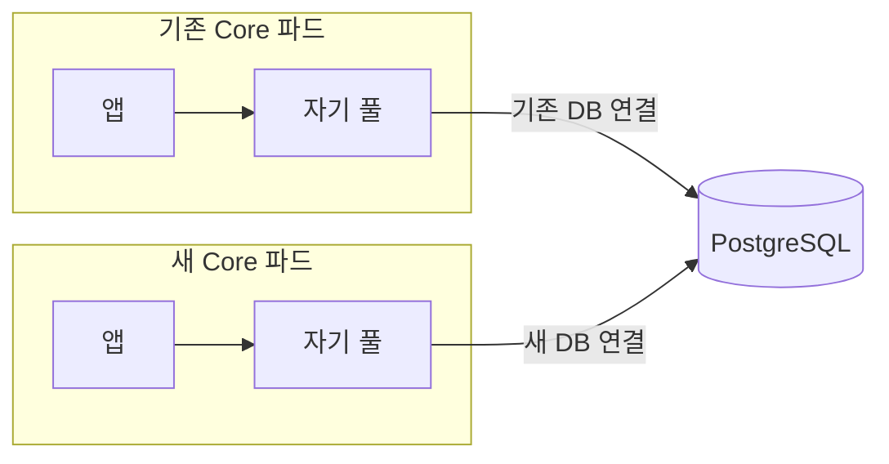
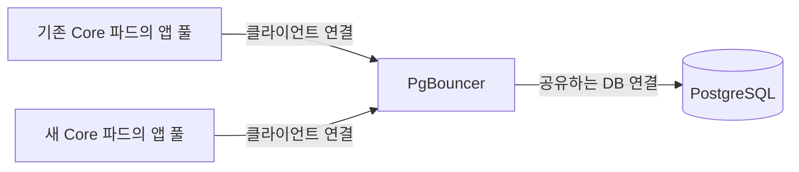
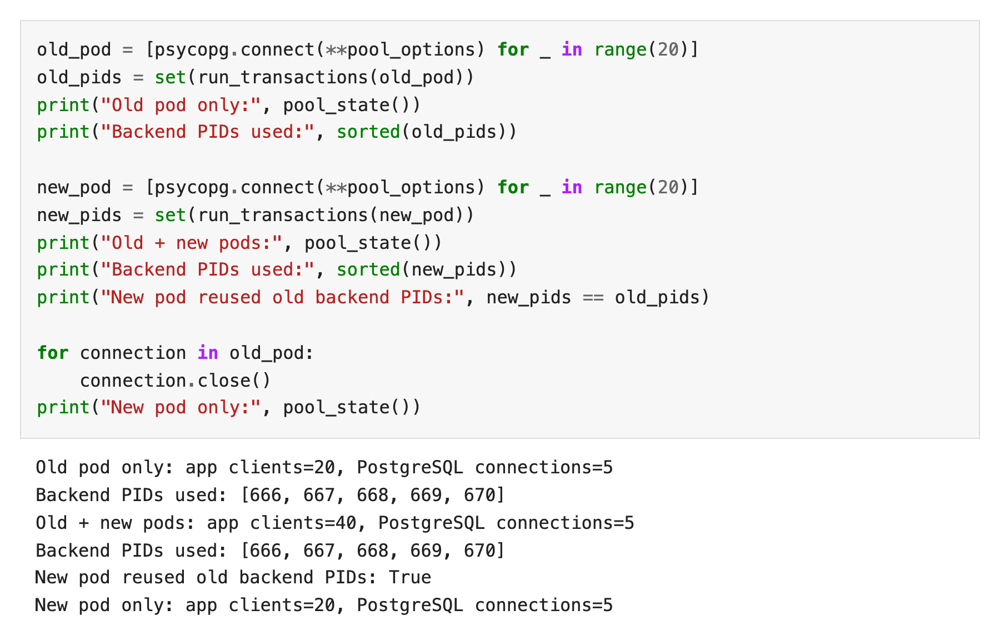
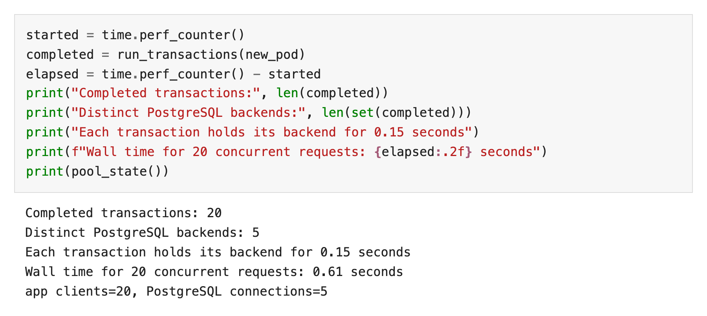

개발 환경에서 Neon을 제거하고 DB를 Azure PostgreSQL로 옮긴 뒤부터 연결 오류가 발생하기 시작했다.

```text
TooManyConnectionsError:
remaining connection slots are reserved for roles with the SUPERUSER attribute
```

DB를 옮기기 전에는 없던 문제라 무엇이 달라졌는지부터 확인했다. 옮겨간 DB의 사양이 더 작았고, 허용되는 연결 수도 줄어 있었다. 앱의 풀 설정은 그대로인데 DB가 받아줄 수 있는 연결 수가 줄면서 기존 연결 규모를 감당하지 못하게 된 것이다.

원인을 파악하고 나니 배포할 때 연결이 더 늘어나는 상황도 같이 보였다.

## 배포할 때는 기존 파드와 새 파드의 연결이 겹친다

롤아웃 중에는 기존 파드가 살아 있는 동안 새 파드가 뜬다. 기존 파드가 풀에 연결을 보관하고 있는 상태에서 새 파드도 자기 풀의 연결을 만들기 때문에, 그동안 DB가 받아야 하는 연결 수는 늘어난다.



각 파드의 풀을 따로 보면 같은 설정으로 동작하고 있지만, DB에는 그 연결들이 모두 합쳐져 들어온다. 낮아진 한도에서는 평소 연결에 이 중복까지 더해지니 버티기 어려웠다.

오류 직후 확인한 스냅샷에는 앱 계정의 idle 연결이 29개 있었다. 이 숫자만으로 전부 풀에 반환된 연결인지까지는 알 수 없지만, 쿼리를 실행하지 않는 연결이 상당수 남아 있던 건 맞다. 기존 파드의 풀에서 놀고 있는 연결을 새 파드가 함께 쓸 수 있다면, 각자 연결을 보관하는 부담을 줄일 수 있지 않을까?

그러다 떠오른 게 PgBouncer였다. PostgreSQL에서 `Too many connections`가 나면 PgBouncer를 붙인다는 말은 거의 공식처럼 들어왔는데, 정작 그게 무슨 일을 해서 문제가 풀리는지는 몰랐다. 혹시 방금 떠올린 게 바로 그 역할일까?

## PgBouncer는 그 연결을 함께 쓰게 해줄까?

PgBouncer는 앱과 PostgreSQL 사이에서 DB 연결 풀을 관리하는 도구다. 앱은 PgBouncer에 접속하고, PostgreSQL 쪽 연결은 PgBouncer가 보유한다. 앱의 요청이 오면 PgBouncer가 보유한 DB 연결을 배정하고, 사용이 끝나면 회수해 다음 요청에 다시 배정한다.



여기서 DB 연결을 언제까지 배정하고 언제 돌려받느냐를 정하는 게 pooling 모드다.

| 모드 | DB 연결을 돌려받는 시점 | 공유하는 단위 |
| --- | --- | --- |
| Session pooling | 클라이언트가 접속을 종료할 때 | 클라이언트 세션 전체 |
| Transaction pooling | 트랜잭션이 끝날 때 | 트랜잭션 |
| Statement pooling | SQL 문장 실행이 끝날 때 | 개별 문장. 여러 문장을 묶는 트랜잭션은 허용하지 않음 |

[PgBouncer pooling modes](https://www.pgbouncer.org/features.html)

session pooling에서는 앱이 PgBouncer 접속을 유지하는 동안 DB 연결도 계속 배정된다. 앱 풀은 접속을 계속 들고 있으니, 쿼리가 없는 시간에도 PgBouncer는 그 DB 연결을 다른 앱에 빌려줄 수 없다. 이러면 앱이 DB에 직접 붙는 것과 크게 다르지 않다.

### transaction pooling이면 다른 파드가 같은 DB 연결을 쓴다

transaction pooling은 앱 접속이 유지되더라도 트랜잭션이 끝나면 DB 연결을 돌려받는다.

```text
기존 파드 → PgBouncer → DB 연결 1 사용 → COMMIT → 반환
새 파드   → PgBouncer → DB 연결 1 재사용
```

이걸 롤아웃 상황에 대입하면, 새 파드가 접속할 때 늘어나는 것은 앱과 PgBouncer 사이의 연결이다. 그 수만큼 PostgreSQL 연결을 새로 만들 필요는 없다. 기존 파드가 트랜잭션을 마치고 반환한 DB 연결을 새 파드의 작업에 배정하면 된다.

아, 이런 의미에서 PgBouncer를 쓰는 거구나. 각 앱이 자기 안에서만 재사용하던 연결을 여러 앱이 함께 재사용하게 만드는 것이다. 그렇다고 idle 연결이 사라지는 건 아니다. PgBouncer 쪽에도 idle DB 연결은 남는다. 달라지는 건 **그 연결의 다음 사용자가 같은 파드여야 한다는 제약이 풀린다는 것**이다.

### 실제로 같은 backend를 재사용할까?

설명대로라면 클라이언트가 늘어도 DB 연결은 그대로여야 한다. 로컬 Docker에서 PostgreSQL 18.6과 PgBouncer 1.26.1을 띄워 확인했다. 뒤에서 비교할 MySQL 8.4.13도 같은 환경에 띄웠다. 컨테이너는 Linux ARM64이고, 두 DB에 각각 CPU 2개·메모리 1 GiB 한도를 두고 PostgreSQL의 `shared_buffers`와 MySQL의 InnoDB buffer pool을 128 MiB로 맞췄다.

실제 Kubernetes 롤아웃 대신, 연결을 20개씩 유지하는 클라이언트 그룹 두 개로 기존 파드와 새 파드가 겹치는 상황을 흉내 냈다. PgBouncer 설정은 다음과 같다.

```ini
pool_mode = transaction
default_pool_size = 5
reserve_pool_size = 0
max_client_conn = 150
```

각 연결에서 `pg_backend_pid()`를 조회하면 실제로 작업한 PostgreSQL backend를 알 수 있다. 연결 수가 그대로라는 것만으로는 재사용이라고 단정하기 어렵지만, 새 그룹에서도 같은 PID가 나온다면 같은 backend를 다시 썼다는 직접적인 증거가 된다. 트랜잭션은 `pg_sleep(0.15)`로 잠시 유지하고, 그룹 안의 연결들에서 동시에 실행했다.



앱 연결은 **20 → 40 → 20개**로 바뀌는데 DB 연결은 **5개**로 유지됐다. 새 그룹에서 작업한 backend PID도 기존 그룹의 PID 5개와 같았다. 앱 연결 수는 PgBouncer의 `SHOW CLIENTS`로, DB 연결 수는 `pg_stat_activity`의 `client backend`에서 측정용 접속을 빼고 셌다.

새 앱 접속이 생기는 것과 새 PostgreSQL backend가 생기는 것이 분리됐다. 롤아웃으로 파드가 겹쳐도 DB가 받는 연결은 PgBouncer의 풀 크기를 넘지 않는다는 뜻이다.

### 공유했을 때 생기는 단점은 없을까?

공유한다고 DB 처리 능력이 늘어나는 건 아니다. 서로 다른 시점에 들어오는 짧은 트랜잭션은 연결 5개를 번갈아 쓸 수 있지만, 동시에 몰리면 나머지는 기다린다. 같은 환경에서 0.15초짜리 트랜잭션 20개를 한꺼번에 요청해봤다.



모두 끝나는 데 약 0.61초가 걸렸다. 5개씩 네 차례 처리하는 데 필요한 0.6초와 거의 같다. 연결을 적게 유지하는 대가로 남은 요청은 줄을 선다. 처리량 벤치마크가 아니라, 일부러 대기 시간을 넣어 배정 방식을 확인한 실험이다.

그리고 transaction pooling에서는 다음 트랜잭션이 같은 DB 연결을 받는다는 보장이 없다. `LISTEN`이나 세션 단위 advisory lock처럼 세션에 상태를 남기는 기능은 맞지 않는다. [PgBouncer 모드별 호환성](https://www.pgbouncer.org/features.html)

prepared statement도 여기에 걸린다. 위 실험은 psycopg의 `prepare_threshold=None`으로 prepared statement를 꺼둔 상태였다. 그런데 우리 앱이 쓰는 asyncpg는 기본으로 prepared statement를 캐시한다. 그대로 transaction pooling에 붙이면 어떤 연결에 만들어둔 statement를 다른 연결에서 찾게 될 수 있으니, asyncpg의 `statement_cache_size`나 PgBouncer의 `max_prepared_statements`를 따로 확인해야 한다. [PgBouncer 설정](https://www.pgbouncer.org/config.html)

연결 수를 계산할 때도 주의할 점이 있다. 풀은 DB와 사용자 조합마다 나뉘고, PgBouncer를 여러 인스턴스로 띄우면 인스턴스마다 풀을 가진다. 그래서 실제 DB 연결 예산은 `default_pool_size × 풀 개수 × 인스턴스 수`로 따져봐야 한다.

## 그런데 MySQL에서는 왜 이런 도구 이야기를 덜 들었을까?

여기까지 보고 나니 궁금한 게 하나 생겼다. 내가 알기로 MySQL에서는 이런 도구를 따로 붙이지 않고 쓰는 경우가 많았다.

MySQL도 파드마다 앱 풀이 있고, 파드가 늘면 DB 연결도 늘어나는 건 똑같다. 같은 구조인데 왜 PostgreSQL에서 PgBouncer 이야기가 유독 자주 나올까? 프로세스 기반인 PostgreSQL과 스레드 기반인 MySQL의 차이 때문일까?

### 연결을 맡는 실행 단위가 다르다

PostgreSQL 18은 클라이언트 연결마다 backend 프로세스를 만든다. 그 backend가 SQL을 받아 파싱하고 실행하며, 연결이 유지되는 동안 다음 명령을 기다린다. MySQL 8.4의 기본 방식은 하나의 `mysqld` 프로세스 안에서 연결마다 전용 스레드를 배정하는 것이다. [PostgreSQL 연결 처리](https://www.postgresql.org/docs/18/connect-estab.html), [MySQL 연결 처리](https://dev.mysql.com/doc/refman/8.4/en/connection-interfaces.html)

```text
PostgreSQL: 연결 A → backend 프로세스 A
            연결 B → backend 프로세스 B

MySQL:      연결 A → mysqld 안의 스레드 A
            연결 B → mysqld 안의 스레드 B
```

MySQL은 연결이 끊기면 담당 스레드를 thread cache에 남겼다가 다음 접속에 재사용하기도 한다. 다만 여기서 재사용하는 건 서버 스레드이고, 새 클라이언트는 여전히 접속과 인증을 거친다. 연결 자체를 유지하는 앱 풀이나 PgBouncer와는 다른 이야기다.

그런데 thread cache는 연결을 새로 만들 때의 이야기다. 우리 앱은 이미 풀로 연결을 유지하고 있었으니, 궁금한 건 연결을 새로 만드는 비용보다 **만들어둔 연결을 idle로 들고 있는 비용**이었다.

### idle 연결 40개를 붙여서 비교해봤다

OS에서 배운 대로라면 PostgreSQL은 연결마다 주소 공간을 가진 프로세스가 하나씩 늘고, MySQL은 같은 프로세스 안에 스레드 스택과 연결 상태만 늘어야 한다. 이 차이가 실제로 얼마나 쌓이는지 찍어봤다. [PostgreSQL 공유 버퍼](https://www.postgresql.org/docs/18/runtime-config-resource.html#GUC-SHARED-BUFFERS), [MySQL 메모리 사용](https://dev.mysql.com/doc/refman/8.4/en/memory-use.html)

앞과 같은 환경에서 이번에는 PgBouncer 없이 두 DB에 직접 접속했다. 컨테이너를 새로 띄운 뒤, 파이썬에서 연결 40개를 열어 `SELECT 1`을 한 번씩 실행하고 그대로 들고 있게 했다.

```python
connections = [psycopg.connect("host=127.0.0.1 port=55432 dbname=lab user=lab password=lab")
               for _ in range(40)]
for connection in connections:
    connection.execute("SELECT 1").fetchone()
```

그리고 연결을 열기 전과 연 뒤에 터미널에서 컨테이너를 들여다봤다. 프로세스는 `docker top`으로 봤다. 컨테이너 안에서 도는 프로세스 목록을 보여주는데, `-o`로 고른 칸 중 `NLWP`가 그 프로세스의 스레드 수다.

```console
$ docker top blog-connection-lab-postgres-1 -o pid,nlwp,args
PID     NLWP    COMMAND
45766   1       postgres -c max_connections=150 -c shared_buffers=128MB
46003   1       postgres: io worker 0
46004   1       postgres: io worker 1
46005   1       postgres: io worker 2
46006   1       postgres: checkpointer
46007   1       postgres: background writer
46009   1       postgres: walwriter
46010   1       postgres: autovacuum launcher
46011   1       postgres: logical replication launcher
```

연결이 하나도 없는데도 프로세스가 9개 떠 있다. checkpointer, walwriter 같은 백그라운드 작업용이다. 여기에 연결 40개를 붙이고 다시 봤다.

```console
$ docker top blog-connection-lab-postgres-1 -o pid,nlwp,args
PID     NLWP    COMMAND
45766   1       postgres -c max_connections=150 -c shared_buffers=128MB
...
46699   1       postgres: lab lab 172.19.0.1(60260) idle
46700   1       postgres: lab lab 172.19.0.1(60266) idle
...
46738   1       postgres: lab lab 172.19.0.1(60616) idle

$ docker top blog-connection-lab-postgres-1 -o pid | tail -n +2 | wc -l
49
```

`postgres: lab lab ... idle`이라는 프로세스가 연결마다 하나씩, 40개 생겼다. 스레드는 전부 1개다. 연결 하나가 정말 프로세스 하나였다.

MySQL은 같은 걸 해도 목록이 한 줄뿐이다.

```console
$ docker top blog-connection-lab-mysql-1 -o pid,nlwp,args
PID     NLWP    COMMAND
45761   37      mysqld --max-connections=150 --innodb-buffer-pool-size=134217728

# 연결 40개를 붙인 뒤
$ docker top blog-connection-lab-mysql-1 -o pid,nlwp,args
PID     NLWP    COMMAND
45761   77      mysqld --max-connections=150 --innodb-buffer-pool-size=134217728
```

프로세스는 그대로 1개이고, 스레드만 **37 → 77개**로 40개 늘었다.

메모리는 조금 더 고민이 필요했다. 단순하게는 프로세스마다 메모리 사용량(RSS)을 구해서 더하면 될 것 같았는데, PostgreSQL에서는 이 방법이 맞지 않는다고 한다. `shared_buffers` 때문인 것 같다. backend 프로세스들은 `shared_buffers`라는 공유 메모리를 함께 쓰는데, RSS는 공유 메모리도 각 프로세스의 사용량에 넣어서 보여준다. 프로세스 40개의 RSS를 그대로 더하면 같은 공유 메모리를 여러 번 세게 된다.

그래서 프로세스 하나하나가 아니라 컨테이너 전체가 쓰는 메모리를 봤다. Docker는 cgroup으로 컨테이너의 자원을 제한하고, cgroup은 그 안에서 쓰는 메모리를 집계해 파일로 보여준다. `memory.current`는 컨테이너 전체 사용량이라 공유 메모리도 한 번만 들어간다. 그런데 여기에는 연결과 상관없는 것도 들어 있었다.

찾아보니 리눅스는 메모리를 크게 두 종류로 나눠서 센다. 하나는 디스크의 파일과 연결된 메모리(file)다. 읽어 온 파일을 담아두는 캐시나 실행 파일을 올려둔 영역이 여기에 속하고, 원본이 디스크에 있으니 필요하면 버렸다가 다시 읽으면 된다. 다른 하나는 대응하는 파일이 없는 메모리(anon, anonymous)다. 프로세스가 `malloc`으로 잡은 힙이나 스레드 스택이 여기에 속한다. `memory.current`는 이 둘을 합친 값이라, 측정하는 사이에 디스크를 읽어 캐시가 늘면 연결과 상관없는 변화가 섞인다.

그러면 idle 연결의 비용은 어느 쪽에 쌓일까? PostgreSQL backend가 자기 몫으로 쓰는 힙과 스택, MySQL 연결 스레드의 스택과 연결 상태는 모두 프로세스가 직접 잡은 메모리, 즉 anon이다. 반대로 `shared_buffers` 같은 공유 메모리는 cgroup에서 file 쪽으로 분류된다. 그래서 `memory.stat`의 `anon` 값을 따로 보면 캐시 변화도 빠지고 공유 메모리도 빠진, **연결이 늘면서 프로세스와 스레드가 새로 잡은 메모리**에 가깝게 볼 수 있다. 전체 그림을 놓치지 않으려고 `memory.current`도 같이 적었다. [Linux cgroup v2 메모리 지표](https://docs.kernel.org/admin-guide/cgroup-v2.html)

```console
$ docker exec blog-connection-lab-postgres-1 cat /sys/fs/cgroup/memory.current
80506880
$ docker exec blog-connection-lab-postgres-1 grep '^anon ' /sys/fs/cgroup/memory.stat
anon 5513216
```

단위가 바이트라서, 연결을 붙이기 전과 후에 같은 값을 읽어 MiB로 바꿔 정리했다.

| | `memory.current` | `anon` |
| --- | --- | --- |
| PostgreSQL | 76.8 → 136.5 MiB (**+59.7**) | 5.3 → 55.1 MiB (**+49.8**) |
| MySQL | 435.5 → 443.9 MiB (**+8.3**) | 421.2 → 428.2 MiB (**+7.1**) |

상태마다 한 번씩 읽은 값이라 조금은 흔들릴 수 있다. 그래도 이 조건에서는 PostgreSQL의 idle 연결이 더 비쌌다.

다만 MySQL은 연결을 붙이기 전 기본 메모리부터 더 컸다. 여기서 비교한 건 총량이 아니라 **idle 연결 40개를 추가했을 때의 증가분**이다. 데이터 없이 `SELECT 1`만 실행한 결과라서, 운영 환경의 연결당 비용이나 두 DB의 일반적인 배율로 볼 수는 없다. 실제 쿼리가 돌면 PostgreSQL의 `work_mem`이나 MySQL의 작업별 버퍼 같은 실행 비용이 따로 붙는데, 이번 측정은 거기까지 보지 않았다. [PostgreSQL 작업 메모리](https://www.postgresql.org/docs/18/runtime-config-resource.html#GUC-WORK-MEM), [MySQL 작업별 버퍼](https://dev.mysql.com/doc/refman/8.4/en/memory-use.html)

그래도 앞의 PgBouncer 실험과 이어서 보면 그림이 맞춰진다. 클라이언트 40개를 PostgreSQL 연결 5개로 받으면, backend 프로세스도 40개 대신 5개만 유지하면 된다. PostgreSQL에서는 idle 연결 하나가 프로세스 하나라서, 연결을 공유했을 때 아끼는 양이 크다. PgBouncer 이야기가 유독 PostgreSQL에서 자주 나오는 이유는 이쪽에 가까워 보인다.

### 그래도 MySQL에 공유할 이유가 없는 건 아니다

MySQL은 연결을 싸게 유지할 수 있지만, `max_connections` 한도는 똑같이 있다. 롤아웃으로 여러 앱 풀의 연결이 합쳐져 한도를 넘으면 MySQL도 새 접속을 거절한다. [MySQL 연결 한도 오류](https://dev.mysql.com/doc/refman/8.4/en/too-many-connections.html)

찾아보니 MySQL에도 **ProxySQL의 multiplexing**이 있었다. 여러 클라이언트가 더 적은 MySQL 연결을 번갈아 쓰게 하는 기능이고, 트랜잭션이 진행 중이거나 세션 상태 때문에 공유할 수 없는 동안에는 연결을 그 클라이언트에 묶어둔다. PgBouncer의 transaction pooling과 같은 발상이다. [ProxySQL multiplexing](https://proxysql.com/documentation/multiplexing/)

결국 연결을 공유해야 하는 이유는 두 DB 모두 같다. 앱마다 따로 풀을 들고 있는 한, 다른 앱의 idle 연결을 가져다 쓸 방법은 없다. 프로세스냐 스레드냐는 그 idle 연결 하나가 얼마나 비싸냐를 바꿀 뿐이고, PostgreSQL은 그 값이 커서 PgBouncer가 거의 기본처럼 따라붙는 것 같다.

## 다시 우리 연결 문제로 돌아오면

우리 환경에서는 우선 DB 사양과 연결 한도를 올렸고, 10월 19일 증설 이후 약 65시간 동안 Core 로그에 같은 연결 한도 오류는 없었다. 앞으로의 최대 부하까지 검증한 건 아니지만 당장 여유는 생겼다.

이제 보고 싶은 건 현재 `pool_size=20`, `max_overflow=10`에서 실제로 동시에 빌려 쓰는 연결 수와 대기 시간이다. 배포 중 겹치는 파드까지 포함해 필요한 연결 규모를 알면, 앱 풀을 줄이는 걸로 충분한지 PgBouncer로 공유할 만한지 판단할 수 있을 것 같다. PgBouncer로 간다면 asyncpg의 prepared statement부터 맞춰야 한다.

실험에 사용한 [노트북](/assets/notebooks/postgres-mysql-connections.ipynb)과 [Docker 설정을 포함한 재현 코드](/assets/experiments/postgres-connections/connection-lab.zip)를 남긴다.
