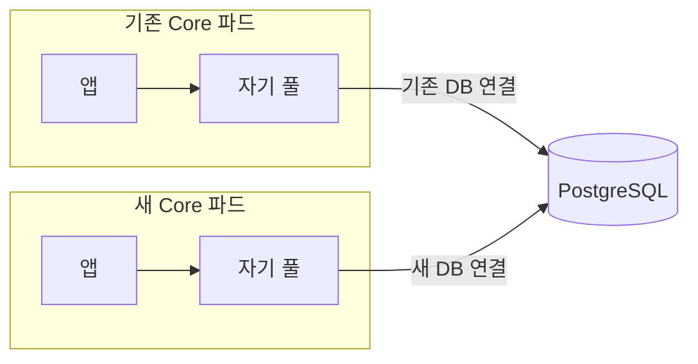
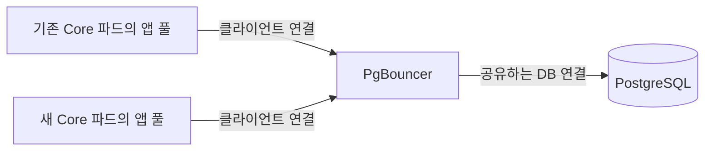

개발 환경에서 Neon을 제거하고 DB를 Azure PostgreSQL로 옮긴 뒤부터 연결 오류가 발생하기 시작했다.

```text
TooManyConnectionsError:
remaining connection slots are reserved for roles with the SUPERUSER attribute
```

이전에는 없던 문제라 이전 전후의 차이를 확인했다. 옮겨간 DB의 사양이 더 작았고, 허용되는 연결 수도 줄어 있었다. 앱의 풀 설정은 그대로인데 DB가 받아줄 수 있는 연결 수가 줄면서 기존 연결 규모를 감당하지 못하게 된 것이다.

원인을 파악하고 나니 배포할 때 연결이 더 늘어나는 상황도 같이 보였다.

## 배포할 때는 기존 파드와 새 파드의 연결이 겹친다

롤아웃 중에는 기존 파드가 살아 있는 동안 새 파드가 뜬다. 기존 파드가 풀에 연결을 보관하고 있는 상태에서 새 파드도 자기 풀의 연결을 만들기 때문에, 그동안 DB가 받아야 하는 연결 수는 늘어난다.



낮아진 연결 한도에서는 평소 연결을 유지하는 것뿐 아니라 이 중복까지 감당하기 어려웠다. 각 파드의 풀을 따로 보면 같은 설정으로 동작하고 있지만, DB에는 그 연결들이 모두 합쳐져 들어온다.

오류 직후 확인한 스냅샷에는 앱 계정의 idle 연결이 29개 있었다. 이 숫자만으로 전부 풀에 반환된 연결인지까지는 알 수 없지만, 실제 쿼리를 실행하지 않는 연결도 상당수 남아 있었다. 기존 파드의 풀에서 대기하는 연결을 새 파드가 함께 쓸 수 있다면, 각자 연결을 보관하는 부담을 줄일 수 있지 않을까?

그래서 이런 문제를 해결해주는 역할이 PgBouncer인가?

PostgreSQL의 `Too many connections`는 PgBouncer를 설정해서 해결한다는 말을 거의 공식처럼 주워들었다. 이참에 PgBouncer가 우리 구조에서 정확히 어떤 역할을 하는지 알아보기로 했다.

## PgBouncer가 그 연결을 함께 쓰게 해주는 걸까?

PgBouncer는 앱과 PostgreSQL 사이에서 DB 연결 풀을 관리하는 도구다. 앱의 접속을 받은 뒤 실제 DB 연결을 배정하고, 사용이 끝난 연결을 회수해 재사용한다. 앱은 PgBouncer에 연결하고, PostgreSQL 쪽 연결은 PgBouncer가 보유하는 구조다.



여기서 DB 연결을 언제까지 배정하고 언제 돌려받느냐를 정하는 게 pooling 모드다.

| 모드 | DB 연결을 돌려받는 시점 | 공유하는 단위 |
| --- | --- | --- |
| Session pooling | 클라이언트가 접속을 종료할 때 | 클라이언트 세션 전체 |
| Transaction pooling | 트랜잭션이 끝날 때 | 트랜잭션 |
| Statement pooling | SQL 문장 실행이 끝날 때 | 개별 문장. 여러 문장을 묶는 트랜잭션은 허용하지 않음 |

[PgBouncer pooling modes](https://www.pgbouncer.org/features.html)

session pooling에서는 앱이 PgBouncer 접속을 유지하는 동안 DB 연결도 계속 배정된다. 앱 풀이 접속을 오래 유지한다면, 쿼리가 없는 시간에도 그 연결을 다른 앱에 빌려줄 수 없다. transaction pooling은 앱 접속이 유지되더라도 트랜잭션이 끝나면 DB 연결을 돌려받는다. statement pooling은 여러 SQL을 하나의 트랜잭션으로 묶는 사용을 제한한다.

### 우리에게 필요한 역할은 transaction pooling에 있었다

그러면 내가 생각한 역할이 맞다. 기존 파드가 작업을 마친 DB 연결을 새 파드의 작업에 빌려주는 건 transaction pooling으로 가능하다.

앱 A가 트랜잭션을 처리하는 동안 DB 연결 하나를 배정받는다. 커밋이나 롤백으로 트랜잭션이 끝나면 그 연결은 PgBouncer 풀로 돌아간다. 다음에는 앱 B가 같은 DB 연결을 사용할 수 있다. A와 PgBouncer 사이의 접속은 계속 유지되어도 된다. [PgBouncer pooling modes](https://www.pgbouncer.org/features.html)

```text
기존 파드 → PgBouncer → DB 연결 1 사용 → COMMIT → 반환
새 파드   → PgBouncer → DB 연결 1 재사용
```

이걸 롤아웃 상황에 대입하면 된다. 새 파드가 접속할 때 늘어나는 것은 우선 앱과 PgBouncer 사이의 연결이다. 그 수만큼 PostgreSQL 연결을 새로 만들 필요는 없다. 기존 파드가 트랜잭션을 마치고 반환한 DB 연결을 새 파드의 작업에 배정할 수 있다.

아, 이런 의미에서 PgBouncer를 쓰는 거구나. 각 앱이 자기 안에서 재사용하던 연결을, 여러 앱이 함께 재사용할 수 있게 만드는 것이다. 모노레포에서 Core의 풀 설정을 한 군데에 두는 것과는 다르다. 설정을 공유해도 실행 중인 풀은 프로세스마다 따로 있으니까.

PgBouncer에도 idle DB 연결은 남는다. idle 자체를 없애려는 게 아니라, **다음 사용자가 같은 파드의 요청이어야 한다는 제약을 풀어주는 것**에 가깝다. 앱 접속이 많고 실제 트랜잭션은 짧고 간헐적이라면, 각자 보관하던 것보다 적은 DB 연결로 처리할 여지가 생긴다.

### 실제로 새 클라이언트가 같은 DB 연결을 쓰는지 확인해봤다

설명대로라면 클라이언트가 늘어도 DB 연결을 재사용해야 한다. 로컬 Docker에서 PostgreSQL 18.6과 PgBouncer 1.26.1을 띄워 확인했다. 아래 비교에 사용할 MySQL은 8.4.13이다. 컨테이너는 Linux ARM64이고, 두 DB에 각각 CPU 2개·메모리 1 GiB 한도를 뒀다. PostgreSQL의 `shared_buffers`와 MySQL의 InnoDB buffer pool은 각각 128 MiB로 설정했다.

실제 Kubernetes 롤아웃 대신 연결을 20개씩 유지하는 두 클라이언트 그룹으로 기존 파드와 새 파드가 겹치는 상황을 흉내 냈다. PgBouncer는 하나의 DB·사용자 풀에서 다음과 같이 설정했다.

```ini
pool_mode = transaction
default_pool_size = 5
reserve_pool_size = 0
max_client_conn = 150
```

각 연결에서 `pg_backend_pid()`를 조회하면 실제로 작업한 PostgreSQL backend를 알 수 있다. 같은 PID들이 다시 나온다면 단순히 연결 수만 같아 보이는 것보다 재사용을 더 직접적으로 확인할 수 있다. 트랜잭션은 `pg_sleep(0.15)`로 잠시 유지하고, 여러 클라이언트에서 동시에 실행했다.

<details markdown="1">
<summary>연결 설정과 트랜잭션·연결 수 측정 코드</summary>

```python
import subprocess
import time
from concurrent.futures import ThreadPoolExecutor
from statistics import median

import psycopg
import pymysql

pg_options = dict(host="127.0.0.1", port=55432, dbname="lab",
                  user="lab", password="lab", autocommit=True,
                  prepare_threshold=None)
mysql_options = dict(host="127.0.0.1", port=53306, database="lab",
                     user="lab", password="lab", autocommit=True)
pg_observer = psycopg.connect(**pg_options, application_name="observer")
mysql_observer = pymysql.connect(**mysql_options)
pg_observer.execute("SELECT 1").fetchone()
with mysql_observer.cursor() as cursor:
    cursor.execute("SELECT 1")
    cursor.fetchone()

pool_options = dict(pg_options, port=56432)
pool_observer = psycopg.connect(**dict(pool_options, dbname="pgbouncer"))

def transaction(connection):
    return connection.execute(
        "SELECT pg_backend_pid(), pg_sleep(0.15)"
    ).fetchone()[0]

def run_transactions(connections):
    with ThreadPoolExecutor(max_workers=len(connections)) as executor:
        return list(executor.map(transaction, connections))

def pool_state():
    cursor = pool_observer.execute("SHOW CLIENTS")
    columns = [column.name for column in cursor.description]
    clients = [dict(zip(columns, row)) for row in cursor.fetchall()]
    client_count = sum(row["database"] == "lab" for row in clients)
    server_count = pg_observer.execute("""
        SELECT count(*) FROM pg_stat_activity
        WHERE backend_type = 'client backend'
          AND usename = 'lab' AND pid <> pg_backend_pid()
    """).fetchone()[0]
    return f"app clients={client_count}, PostgreSQL connections={server_count}"
```

</details>


앱 연결은 **20 → 40 → 20개**로 바뀌는데 DB 연결은 **5개**로 유지됐다. 새 그룹에서 작업한 backend PID도 기존 그룹의 PID 5개와 같았다. `SHOW CLIENTS`로 PgBouncer 접속 수를 확인했고, DB 쪽에서는 `pg_stat_activity`의 `client backend`만 세어 측정용 접속을 제외했다.

이 설정에서 새 앱 접속이 생기는 것과 새 PostgreSQL backend가 생기는 것이 분리된 모습을 확인할 수 있었다.

### 공유하는 만큼 달라지는 조건도 있다

같은 풀에 앱 연결 100개와 DB 연결 20개가 있다고 하자. 서로 다른 시점에 들어오는 짧은 트랜잭션은 20개를 번갈아 쓸 수 있다. 하지만 100개가 동시에 긴 트랜잭션을 실행하려 하면 나머지는 기다린다. PgBouncer는 연결을 배정하고 대기시키는 것이지 DB 처리 능력 자체를 늘려주지는 않는다.

같은 실험에서 0.15초씩 연결을 사용하는 작업 20개를 동시에 요청해봤다.


모두 완료되기까지 약 0.61초가 걸렸다. 5개씩 네 차례에 걸쳐 처리하는 데 필요한 약 0.6초와 가까운 결과다. 연결을 적게 유지하는 대신 남은 요청은 기다린다는 것도 같이 보인다. 실제 처리량 벤치마크가 아니라, 일부러 대기 시간을 넣어 연결 배정을 확인한 실험이다.

transaction pooling에서는 다음 트랜잭션이 같은 DB 연결을 받는다는 보장도 없다. `LISTEN`이나 세션 단위 advisory lock처럼 세션에 의존하는 기능은 맞지 않고, prepared statement도 프로토콜과 설정을 확인해야 한다. [PgBouncer 모드별 호환성](https://www.pgbouncer.org/features.html)

또한 DB와 사용자 조합에 따라 풀이 나뉘고, PgBouncer를 여러 인스턴스로 띄우면 각각 풀을 가진다. 실제 공유 범위와 DB 연결 예산은 그 구성에 맞춰 봐야 한다. [PgBouncer 설정](https://www.pgbouncer.org/config.html)

여기까지 보면 우리 같은 상황에서 PgBouncer를 검토하는 이유는 분명하다. 파드 수와 각 앱의 접속 수가 변하더라도 DB 쪽 연결을 별도로 관리하고 재사용할 수 있다.

## 그런데 MySQL에서는 왜 이런 도구 이야기를 덜 들었을까?

그런데 PostgreSQL에서는 이렇게 PgBouncer를 쓰는데, MySQL도 같은 역할을 하는 도구를 쓸까? 내가 알기로는 MySQL에서는 이런 도구를 따로 붙이지 않고 쓰는 경우가 많았다.

MySQL도 파드마다 앱 풀이 있고, 파드가 늘면 DB 연결도 늘어나는 건 똑같다. 같은 구조인데 왜 PostgreSQL에서는 PgBouncer를 같이 쓰는 이야기가 자주 나오는 걸까? 프로세스 기반인 PostgreSQL과 스레드 기반인 MySQL의 차이 때문일까?

그래서 두 DB가 연결을 어떻게 처리하는지부터 찾아봤다.

### 연결을 담당하는 실행 단위가 다르다

PostgreSQL 18은 클라이언트 연결마다 backend 프로세스를 만든다. 그 backend가 SQL을 받아 파싱하고 실행하며, 쿼리가 끝난 뒤에도 연결이 유지되는 동안 다음 명령을 기다린다. MySQL 8.4의 기본 방식은 하나의 `mysqld` 프로세스 안에서 연결마다 전용 스레드를 배정하는 것이다. [PostgreSQL 연결 처리](https://www.postgresql.org/docs/18/connect-estab.html), [MySQL 연결 처리](https://dev.mysql.com/doc/refman/8.4/en/connection-interfaces.html)

```text
PostgreSQL: 연결 A → backend 프로세스 A
            연결 B → backend 프로세스 B

MySQL:      연결 A → mysqld 안의 스레드 A
            연결 B → mysqld 안의 스레드 B
```

MySQL은 연결이 종료되면 담당 스레드를 thread cache에 남겼다가 다음 접속에 재사용할 수도 있다. 여기서 재사용하는 것은 서버 스레드이고, 새 클라이언트는 여전히 접속과 인증을 거친다. 연결 자체를 유지하는 앱 풀과는 역할이 다르다. [MySQL 스레드 관리](https://dev.mysql.com/doc/refman/8.4/en/connection-interfaces.html)

그런데 우리 앱은 이미 풀로 연결을 유지하고 있었다. 새 연결을 만드는 비용뿐 아니라, **만들어둔 연결을 idle로 남겨두는 비용이 얼마나 다른지** 보고 싶었다.

## 연결을 40개씩 유지하면 무엇이 달라질까?

메모리 구조는 OS에서 배운 차이를 떠올리면 된다. PostgreSQL은 backend별 주소 공간과 `shared_buffers` 같은 공유 영역을 두고, MySQL은 같은 프로세스 안에서 스레드별 스택과 연결 상태를 유지한다. 이 차이가 실제로 얼마나 쌓이는지는 직접 찍어보기로 했다. [PostgreSQL 공유 버퍼](https://www.postgresql.org/docs/18/runtime-config-resource.html#GUC-SHARED-BUFFERS), [MySQL 메모리 사용](https://dev.mysql.com/doc/refman/8.4/en/memory-use.html)

같은 로컬 환경에서 이번에는 PgBouncer를 거치지 않고 두 DB에 직접 접속했다. 각 연결에서 `SELECT 1`을 한 번 실행한 뒤 트랜잭션 밖에서 idle로 유지했다. PostgreSQL은 `pg_stat_activity`, MySQL은 `PROCESSLIST`로 앱 연결 40개를 확인했다.

OS 프로세스와 스레드는 컨테이너의 `/proc/<pid>/status`에서 읽었다. 아래 총수에는 백그라운드 작업과 측정용 접속도 포함되므로, 연결 전후의 증가분을 보면 된다.

메모리는 프로세스별 RSS를 합산하지 않고 컨테이너의 cgroup v2 값을 읽었다. `memory.current`는 파일 캐시와 커널 메모리 등을 포함한 컨테이너 전체 값이고, `memory.stat`의 `anon`은 anonymous memory다. 공유 페이지가 여러 프로세스의 RSS에 나타나는 것을 그대로 더하는 방식은 피했다. 각 상태에서 5번 읽은 중앙값을 사용했다. [Linux cgroup v2 메모리 지표](https://docs.kernel.org/admin-guide/cgroup-v2.html)

<details markdown="1">
<summary>프로세스·스레드·메모리 측정 코드</summary>

```python
def os_sample(service):
    output = subprocess.check_output([
        "docker", "exec", f"blog-connection-lab-{service}-1",
        "sh", "-c", """
        for f in /proc/[0-9]*/status; do
            awk '/^Name:/ {name=$2} /^Pid:/ {pid=$2}
                 /^Threads:/ {if (name=="postgres" || name=="mysqld")
                     print "task", pid, $2}' "$f" 2>/dev/null
        done
        cat /sys/fs/cgroup/memory.current
        cat /sys/fs/cgroup/memory.stat
        """
    ], text=True)
    tasks = [tuple(map(int, line.split()[1:]))
             for line in output.splitlines() if line.startswith("task ")]
    current = next(int(line) for line in output.splitlines() if line.isdigit())
    stat = dict(line.split() for line in output.splitlines()
                if not line.startswith("task ") and not line.isdigit())
    return dict(processes=len(tasks), threads=sum(t for _, t in tasks),
                tasks=tasks, memory_mib=current / 2**20,
                anon_mib=int(stat["anon"]) / 2**20)

def measure(service):
    samples = [os_sample(service) for _ in range(5)]
    result = samples[-1]
    result["memory_mib"] = median(s["memory_mib"] for s in samples)
    result["anon_mib"] = median(s["anon_mib"] for s in samples)
    return result

def show_change(name, before, after):
    print(f"{name}: processes {before['processes']} -> {after['processes']}, "
          f"OS threads {before['threads']} -> {after['threads']}")
    print(f"cgroup memory: {before['memory_mib']:.1f} -> "
          f"{after['memory_mib']:.1f} MiB "
          f"(delta {after['memory_mib'] - before['memory_mib']:+.1f})")
    print(f"anonymous memory: {before['anon_mib']:.1f} -> "
          f"{after['anon_mib']:.1f} MiB "
          f"(delta {after['anon_mib'] - before['anon_mib']:+.1f})")
```

</details>


PostgreSQL은 프로세스가 **10 → 50개**로 늘었다. 연결 40개에 backend 프로세스가 40개 추가된 것이다. 실제 연결의 PID 세 개도 뽑아봤는데 각각 OS 스레드는 하나였다.


MySQL은 `mysqld` 프로세스 **1개**를 유지하면서 OS 스레드가 **38 → 78개**로 늘었다. 같은 연결 40개가 프로세스와 스레드로 각각 나타나는 것을 확인했다.

이번 실행에서 컨테이너 전체 메모리 증가분은 PostgreSQL 약 **64.3 MiB**, MySQL 약 **8.2 MiB**였다. anonymous memory 증가분은 각각 약 49.9 MiB와 7.1 MiB였다. 이 조건에서는 PostgreSQL의 idle 연결을 추가하는 비용이 더 크게 측정됐다.

다만 MySQL은 연결을 추가하기 전 기본 메모리부터 더 컸다. 이번에 비교한 것은 그 총량이 아니라 **idle 연결 40개를 추가했을 때의 증가분**이다. 데이터 없이 `SELECT 1`만 실행한 결과이므로 이 숫자를 운영 환경의 연결당 고정 비용이나 두 DB의 일반적인 배율로 볼 수는 없다.

실제 쿼리를 돌리면 PostgreSQL의 정렬·해시 연산에 쓰이는 `work_mem`, MySQL의 작업별 버퍼 같은 비용도 추가된다. 이번 측정은 그 실행 부하까지 비교한 것은 아니다. [PostgreSQL 작업 메모리](https://www.postgresql.org/docs/18/runtime-config-resource.html#GUC-WORK-MEM), [MySQL 작업별 버퍼](https://dev.mysql.com/doc/refman/8.4/en/memory-use.html)

그래도 PgBouncer로 무엇을 아낄 수 있는지는 앞의 실험과 이어졌다. 클라이언트 40개를 실제 PostgreSQL 연결 5개로 받으면, 연결 담당 backend도 40개 대신 5개만 유지하면 된다. 짧게 일하고 오래 대기하는 앱 연결이 많을수록 이 차이가 의미 있어지는 것이다.

## MySQL에도 연결을 공유할 이유는 남는다

이번 조건에서 MySQL의 연결 추가 비용은 더 작았다. 하지만 연결을 더 저렴하게 유지할 수 있어도 `max_connections`라는 한도는 있다. 롤아웃으로 여러 앱 풀의 연결이 합쳐져 그 한도를 넘으면 MySQL에서도 새 접속이 거절된다. [MySQL 연결 한도 오류](https://dev.mysql.com/doc/refman/8.4/en/too-many-connections.html)

찾아보니 MySQL에도 **ProxySQL의 multiplexing**이 있었다. 여러 클라이언트가 더 적은 실제 MySQL 연결을 번갈아 사용하는 기능이다. 진행 중인 트랜잭션이나 특정 세션 상태 때문에 공유가 불가능한 동안에는 해당 연결을 클라이언트에 묶어둔다. [ProxySQL multiplexing](https://proxysql.com/documentation/multiplexing/)

그러면 처음의 “MySQL은 이런 도구를 안 쓰나?”에는 답이 생긴다. MySQL에서도 앱별로 연결을 많이 보관하는 구조라면 외부에서 공유할 이유가 있다. 프로세스와 스레드의 차이는 그때 줄일 수 있는 자원의 비용에 영향을 주지만, 다른 앱의 idle 연결을 자동으로 가져다 쓰게 해주지는 않는다.

## 다시 우리 연결 문제로 돌아오면

우리 환경에서는 우선 DB 사양과 연결 한도를 조정했고, 10월 19일 확인한 증설 이후 약 65시간 동안 Core 로그에서 같은 연결 한도 오류는 없었다. 앞으로의 최대 부하까지 검증한 것은 아니지만 당장 여유는 확보한 상태였다.

이제 보고 싶은 것은 현재 `pool_size=20`, `max_overflow=10`에서 실제로 동시에 빌려 쓰는 연결 수와 대기 시간이다. 배포 중 겹치는 파드까지 포함해 필요한 연결 규모를 확인하면, 앱 풀을 줄여도 되는지, PgBouncer로 공유할 이점이 큰지 판단할 수 있을 것 같다.

실험에 사용한 [노트북](/assets/notebooks/postgres-mysql-connections.ipynb)과 [Docker 설정을 포함한 재현 코드](/assets/experiments/postgres-connections/connection-lab.zip)를 남긴다.
