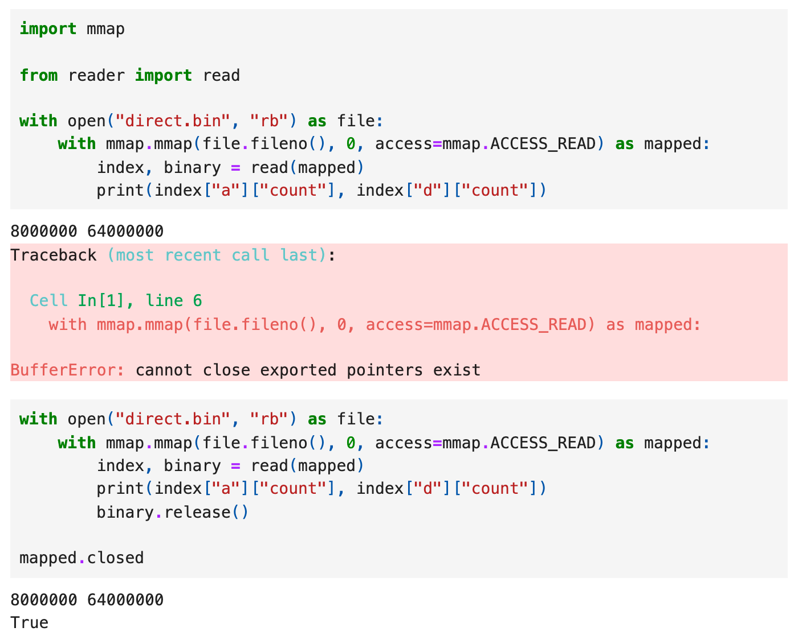

회사에서는 시뮬레이션 데이터를 공통 바이너리 포맷으로 저장한다. 배열을 담다 보면 파일 하나가 수백 MB에서 몇 GB까지 간다.

이 포맷을 읽고 쓰는 코드를 Python으로 짰다. 변환 중인 워커의 메모리를 보니 파일 크기를 감안해도 사용량이 꽤 높았다. 배열은 이미 메모리에 있는데, 그걸 파일에 쓰는 동안 뭐가 더 필요한 걸까?

## 파일은 이렇게 생겼다

맨 앞에 16바이트짜리 헤더가 있고, 그 뒤에 JSON 청크와 바이너리 청크가 붙는다.

```text
┌──────────┬──────────────┬────────────┬──────────────┬─────────────────┐
│ header   │ chunk header │ JSON chunk │ chunk header │ binary chunk    │
│ 16 bytes │ type, length │ index      │ type, length │ A | B | C | ... │
└──────────┴──────────────┴────────────┴──────────────┴─────────────────┘
```

헤더에는 식별자와 버전, **파일 전체 길이**를 적는다. 배열 데이터는 맨 뒤의 바이너리 청크에 순서대로 들어가고, JSON 청크는 필요한 배열을 찾을 때 보는 목차다. 예를 들어 배열 `a`는 이렇게 적혀 있다.

```json
{"a": {"dtype": "uint32", "offset": 0, "count": 8000000}}
```

읽는 쪽에서는 바이너리 청크의 시작점에서 `offset`만큼 건너뛴 뒤 `count`개의 원소를 읽는다. `a`라면 맨 앞부터 `uint32` 800만 개다.

## 저장할 때 메모리는 어디서 늘어났을까?

### 처음 짠 코드

헤더에 전체 길이를 적어야 해서 파일 크기부터 계산했다. 어차피 크기를 아니까 그만큼 `bytearray`를 하나 만들고 헤더부터 차례로 채웠다. 배열은 JSON에 적어 둔 `offset`에 맞춰 넣었다. 호출하는 쪽에서는 완성된 `bytes`를 받아서 파일에 쓰거나 해시를 계산했다.

```python
buffer = bytearray(total)
HEADER.pack_into(buffer, 0, b"DEMO", 1, total)
...
for view in views:
    buffer[offset : offset + view.nbytes] = view
    offset += view.nbytes
result = bytes(buffer)
```

배열마다 타입도 다르고 만든 라이브러리도 달라서, `views`에는 원래 배열을 `memoryview`로 감싸 뒀다. `tobytes()`로 바꿔서 넘기면 파일에 쓰기도 전에 배열마다 사본이 하나 생긴다.

처음엔 급하게 짠 데다 작은 파일로만 테스트해서 그냥 넘어갔다. 다시 보니 `bytearray(total)`에서 파일 크기만 한 버퍼를 만들고, 마지막 `bytes(buffer)`에서 그만큼을 한 번 더 복사한다. 원래 배열에 더해서 파일 두 개만큼 메모리를 쓰겠구나 싶었다.

### 실제로 2배일까?

32MB, 96MB, 32MB, 256MB짜리 NumPy 배열 네 개로 같은 구조의 파일을 만들어 봤다. 헤더와 JSON까지 합쳐서 약 416MB다.

<details markdown="1">
<summary>배열과 JSON 청크를 만드는 코드</summary>

```python
M = 1_000_000

arrays = {
    "a": np.arange(8 * M, dtype=np.uint32),
    "b": np.ones(24 * M, dtype=np.float32),
    "c": np.arange(8 * M, dtype=np.uint32),
    "d": np.ones(64 * M, dtype=np.uint32),
}

views = [memoryview(array).cast("B") for array in arrays.values()]

index = {}
offset = 0
for name, array in arrays.items():
    index[name] = {"dtype": array.dtype.name, "offset": offset, "count": len(array)}
    offset += array.nbytes
binary_length = offset

json_chunk = json.dumps(index).encode()

total = HEADER.size + CHUNK.size + len(json_chunk) + CHUNK.size + binary_length
```

</details>

파일을 쓰는 동안 메모리가 어디까지 올라가는지 보고 싶었다. 맥에서 `/usr/bin/time -l`로 스크립트를 돌리면 프로세스가 물리 메모리를 가장 많이 썼을 때의 값(`maximum resident set size`)이 나온다. Python 코드에 측정 코드를 넣을 필요도 없다. 셸에 내장된 `time`에는 `-l` 옵션이 없어서 경로를 다 적었다.

먼저 배열만 만드는 스크립트를 돌렸다.

```console
$ /usr/bin/time -l python baseline.py
416000294
        0.11 real         0.03 user         0.03 sys
           444907520  maximum resident set size
...
```

첫 줄은 스크립트가 계산한 파일 크기고 `real`은 걸린 시간이다. 여기서 비교할 값은 `444907520`바이트, 약 445MB다. 배열 416MB에 Python과 NumPy가 쓰는 메모리까지 들어 있다. 이번에는 같은 배열을 파일로 써봤다.

```console
$ /usr/bin/time -l python naive.py
        0.25 real         0.08 user         0.13 sys
          1661222912  maximum resident set size
...
```

열 번 넘게 돌려 보니 최대 메모리는 대부분 1,661MB였고 가끔 1,300~1,400MB대까지 내려갔다. 메모리를 적게 쓰는 스크립트에서는 값이 일정해서 macOS의 메모리 압축 때문인가 싶었는데, 압축량까지 재 보지는 않았다.

1,661MB에서 배열만 만들 때 쓴 445MB를 빼면 1,216MB다. 내가 예상한 건 416MB짜리 `bytearray` 하나와 같은 크기의 `bytes` 하나, 합쳐서 832MB였다. 예상보다 384MB를 더 썼다.

### 나머지 384MB는 어디서 왔을까?

마지막 `bytes(buffer)`를 빼도 이 차이가 남는지 보려고, `bytearray`에 배열을 채우는 데까지만 실행했다.

```console
$ /usr/bin/time -l python fill_only.py
        0.17 real         0.07 user         0.08 sys
          1245151232  maximum resident set size
...
```

채우기만 해도 기준보다 800MB를 더 썼다. 버퍼 크기인 416MB를 빼도 여전히 384MB가 남는다. 배열을 버퍼에 넣는 코드는 이 한 줄이다.

```python
buffer[offset : offset + view.nbytes] = view
```

CPython 3.12.13에서 `bytearray`의 슬라이스 대입 코드를 찾아봤다. 오른쪽 값이 `memoryview`면 그걸 `bytearray`로 복사하고, 그 사본으로 대입 함수를 다시 부른다. [CPython 소스](https://github.com/python/cpython/blob/v3.12.13/Objects/bytearrayobject.c#L652-L667)

```c
/* Make a copy and call this function recursively */
values = PyByteArray_FromObject(values);
```

복사를 피하려고 배열을 `memoryview`로 감쌌는데, 정작 `buffer[...] = view`에서 배열만 한 임시 사본이 매번 생기고 있었다. 여기서 만든 사본과 마지막 `bytes(buffer)`에서 만든 사본이 둘 다 꼭 필요한 걸까?

### bytes, bytearray, memoryview는 무엇이 다를까?

셋 다 바이트를 다루는 데 쓰고 있었는데, 데이터를 누가 갖고 있는지와 그 데이터를 바꿀 수 있는지가 달랐다.

| 타입 | 메모리를 직접 갖고 있나 | 내용을 바꿀 수 있나 |
| --- | --- | --- |
| `bytes` | 갖고 있다 | 없다 |
| `bytearray` | 갖고 있다 | 있다 |
| `memoryview` | 없다. 다른 객체의 메모리를 가리킨다 | 가리키는 대상에 따라 다르다 |

NumPy 배열은 버퍼 프로토콜을 통해 원본 메모리를 내준다. 배열 하나를 `memoryview`로 감싸고 `tobytes()`로 사본도 하나 떠 둔 다음, 원래 배열의 첫 값을 바꿔 봤다.

```console
$ python
Python 3.12.13 (main, Jul 18 2026, 16:55:18) [Clang 22.1.3 ] on darwin
Type "help", "copyright", "credits" or "license" for more information.
>>> import numpy as np
>>> a = np.array([1, 2, 3, 4], dtype=np.uint32)
>>> v = memoryview(a)
>>> c = a.tobytes()
>>> a[0] = 99
>>> v.tolist()
[99, 2, 3, 4]
>>> np.frombuffer(c, dtype=np.uint32)
array([1, 2, 3, 4], dtype=uint32)
```

`v`로 보니 첫 값이 99로 바뀌어 있었다. 미리 `tobytes()`로 복사해 둔 `c`에는 여전히 1이 남아 있었다. 앞 코드의 마지막 줄도 마찬가지다. `bytes(buffer)`로 돌려준 값은 나중에 `buffer`를 고쳐도 그대로여야 한다.

아까 CPython 코드에서 임시 사본을 만든 건 `bytearray`의 슬라이스에 대입할 때였다. 이번에는 받는 쪽도 `memoryview`로 감싸서 같은 배열을 옮겨 봤다.

```python
target = memoryview(buffer)
for view in views:
    target[offset : offset + view.nbytes] = view
    offset += view.nbytes
```

```console
$ /usr/bin/time -l python fill_view.py
        0.10 real         0.05 user         0.04 sys
           860962816  maximum resident set size
...
```

이번에는 기준보다 416MB 늘었다. 만들어 둔 버퍼 하나만큼이다. 원본에서 버퍼로 배열을 복사하는 일은 같은데, 슬라이스 대입 때 만들던 임시 `bytearray`는 빠졌다.

그래도 처음에 나온 384MB는 좀 이상하다. 임시 사본은 대입이 끝날 때마다 버려지니 가장 큰 배열 하나(256MB)만큼만 더 들 줄 알았다. 384MB면 96MB, 32MB, 256MB를 다 더한 크기다. 다 쓴 메모리를 할당자가 바로 운영체제에 돌려주지 않아서일까? 여기는 더 파 보지 못했다.

### 파일 크기만 한 버퍼가 꼭 필요할까?

`memoryview`로 채워도 `bytearray(total)`에 필요한 416MB는 그대로 든다. 파일에 쓸 순서는 이미 알고 있으니, 이번에는 빈 버퍼를 만들던 자리에 조각들만 순서대로 놓아 봤다.

```python
pieces = [
    HEADER.pack(b"DEMO", 1, total),
    CHUNK.pack(JSON, len(json_chunk)),
    json_chunk,
    CHUNK.pack(BINARY, binary_length),
    *views,
]
```

헤더와 JSON은 작은 `bytes`고, `views`에는 원래 배열을 가리키는 `memoryview`가 들어 있다. 목록을 만들어도 큰 배열을 또 복사하지는 않는다.

결과를 `bytes`로 돌려줘야 할 때는 이 조각들을 한 번에 합쳐 봤다. `bytes.join()`은 `bytes`만 받는 줄 알았는데 `memoryview`도 그대로 넘길 수 있었다.

```python
result = b"".join(pieces)
```

```console
$ /usr/bin/time -l python join.py
        0.13 real         0.05 user         0.07 sys
           861011968  maximum resident set size
...
```

기준보다 416MB 더 썼다. 딱 결과로 돌려줄 `bytes` 하나만큼이다.

파일로 저장하는 쪽 코드를 보니 그 `bytes`를 받자마자 `write()`에 넘기고 있었다. `write()`도 `memoryview`를 받으니까, 여기서는 조각을 합칠 필요가 없었다.

```python
with open("direct.bin", "wb") as file:
    for piece in pieces:
        file.write(piece)
```

```console
$ /usr/bin/time -l python direct.py
        0.12 real         0.03 user         0.06 sys
           444940288  maximum resident set size
...
```

445MB. 배열만 만들었을 때와 32KB 정도 차이 났다. 원래 배열을 `write()`에 넘기는 것만으로 416MB짜리 파일을 끝까지 쓸 수 있었다.

쓰는 방식을 바꾸고도 같은 파일이 나왔는지는 SHA-256으로 확인했다.

```console
$ shasum -a 256 naive.bin join.bin direct.bin
54f75f0ed5a1d04e96a95e1a8ad8611d211a7a93bc2bb1484b8f08fe8138c5db  naive.bin
54f75f0ed5a1d04e96a95e1a8ad8611d211a7a93bc2bb1484b8f08fe8138c5db  join.bin
54f75f0ed5a1d04e96a95e1a8ad8611d211a7a93bc2bb1484b8f08fe8138c5db  direct.bin
```

세 파일의 해시는 같았다. 아래에서 추가 메모리는 배열만 만들었을 때(445MB)와의 차이고, MB 단위로 반올림했다.

| 방식 | 최대 메모리 | 추가 메모리 | 추가 메모리 / 파일 크기 |
| --- | --- | --- | --- |
| `bytearray`에 채우고 `bytes`로 변환 | 1,661MB | 1,216MB | 약 2.9배 |
| 조각을 `b"".join`으로 합침 | 861MB | 416MB | 1배 |
| 조각을 파일에 바로 씀 | 445MB | 0MB | 0배 |

헤더에 파일 크기를 먼저 적어야 한다는 건 처음 생각한 대로였다. 그런데 길이는 조각 크기를 더하면 나오고, `offset`도 조각을 순서대로 쓰면 맞는다. 처음 코드를 짤 때는 크기를 미리 아는 것과 그만큼 메모리를 잡는 걸 한 묶음으로 생각했다.

## 원소 개수만 보는데 파일을 다 읽어야 할까?

파일을 쓸 때 앞쪽 JSON 청크에 배열마다 원소 개수를 `count`로 적어 뒀다. 그런데 그 개수만 꺼내는 코드에서도 `file.read()`로 뒤에 붙은 배열까지 통째로 읽고 있었다.

### 전체를 읽어서 넘겨 봤다

우리 reader는 파일 전체가 담긴 버퍼를 받는다. 헤더에 적힌 전체 길이를 버퍼 크기와 대조한 다음, 청크 헤더를 따라가면서 JSON과 배열의 위치를 찾는다. 방금 쓴 416MB짜리 파일에서 `a`와 `d`의 원소 개수를 꺼내 봤다.

```python
with open("direct.bin", "rb") as file:
    data = file.read()

index, binary = read(data)
print(index["a"]["count"], index["d"]["count"])
```

```console
$ /usr/bin/time -l python read_all.py
8000000 64000000
        0.19 real         0.01 user         0.08 sys
           433373184  maximum resident set size
...
```

숫자 두 개를 꺼내려고 433MB를 썼다.

앞부분만 읽어서 JSON을 직접 해석할 수도 있다. 그러려면 헤더가 몇 바이트고 JSON이 어디서 시작하는지를 reader 밖에도 한 번 더 써야 한다. 포맷이 바뀔 때마다 두 군데를 고치기는 싫었다. reader에는 지금처럼 파일 전체를 넘기면서 필요한 부분만 읽을 방법이 있을까?

### reader에 mmap을 넘겨 봤다

찾아보다가 `mmap`이 눈에 들어왔다. 파일을 프로세스의 주소 공간에 연결해 두고, 그 주소를 읽을 때 운영체제가 필요한 페이지를 메모리에 올려 주는 방식이라고 한다.

`mmap` 객체도 버퍼 프로토콜을 지원하고 `len(data)`로 파일 전체 길이를 확인할 수 있다. reader는 그대로 두고 `file.read()` 하던 한 줄만 바꿔 봤다.

```python
with open("direct.bin", "rb") as file:
    data = mmap.mmap(file.fileno(), 0, access=mmap.ACCESS_READ)

index, binary = read(data)
```

```console
$ /usr/bin/time -l python read_mmap.py
8000000 64000000
        0.02 real         0.00 user         0.00 sys
            17514496  maximum resident set size
...
```

같은 숫자 두 개를 꺼냈는데 최대 메모리가 433MB에서 17.5MB로 줄었다. 아무 일도 안 하는 Python 프로세스가 16.5MB였으니 1MB 정도 더 쓴 셈이다.

`file.read()`를 쓸 때는 reader를 부르기도 전에 416MB짜리 `bytes`가 생겼다. 파일 내용이 운영체제 캐시에 있어서 디스크를 다시 읽을 필요가 없어도, 그 `bytes`에 내용을 복사하는 데는 메모리가 든다. `mmap`으로 열었을 때 reader가 실제로 읽은 건 `count`를 찾는 데 필요한 헤더와 JSON뿐이었다.

### 200MB 구간을 띄엄띄엄 읽어 봤다

그럼 뒤쪽 배열까지 읽으면 메모리도 그만큼 늘어날까? 이번에는 배열의 200MB 구간을 4KB 간격으로 한 바이트씩 읽어 봤다.

```console
$ /usr/bin/time -l python read_mmap_part.py
48829
        0.02 real         0.01 user         0.00 sys
           217464832  maximum resident set size
...
```

217MB였다. 한 바이트씩 띄엄띄엄 읽었는데 메모리는 훑고 지나간 구간만큼, 약 200MB가 늘었다.

운영체제는 메모리를 페이지 단위로 관리한다. 매핑된 주소를 읽을 때 그 페이지가 아직 프로세스에 연결돼 있지 않으면 page fault가 난다고 한다. `/usr/bin/time -l`에는 디스크를 읽지 않고 처리한 page fault 횟수도 `page reclaims`로 나온다. 방금 쓴 파일이라 내용이 운영체제 캐시에 남아 있을 것 같아서 이 값도 같이 봤다.

```console
$ pagesize
16384
$ /usr/bin/time -l python -c pass
...
                1325  page reclaims
...
$ /usr/bin/time -l python read_mmap.py
8000000 64000000
...
                1383  page reclaims
...
$ /usr/bin/time -l python read_mmap_part.py
48829
...
               13595  page reclaims
...
$ /usr/bin/time -l python read_all.py
8000000 64000000
...
               26323  page reclaims
...
```

이 맥에서는 한 페이지가 16,384바이트다. 빈 Python 프로세스보다 `page reclaims`가 몇 번 더 나왔는지 보고, 거기에 페이지 크기를 곱해 봤다.

| 스크립트 | 늘어난 page reclaims | × 16KB | 늘어난 최대 메모리 |
| --- | --- | --- | --- |
| `mmap`으로 개수만 조회 | 58 | 약 1MB | 약 1MB |
| `mmap`으로 200MB 구간 접근 | 12,270 | 약 201MB | 약 201MB |
| 전체를 읽어서 조회 | 24,998 | 약 410MB | 약 417MB |

200MB 구간을 읽었을 때 늘어난 횟수에 페이지 크기를 곱하면 약 201MB다. 최대 메모리가 늘어난 양과 거의 맞았다. `count`만 꺼낸 쪽은 58회 차이였다. 이건 Python 프로세스 전체에서 센 횟수라, 파일의 어느 페이지를 읽었는지까지는 알 수 없다.

### mmap을 닫을 때 걸린 점

앞 예제에선 파일만 `with`로 열었다. 이번엔 원소 개수 두 개를 읽고 나면 `mmap`도 같이 닫히도록 해 봤다.



원소 개수는 두 번 다 잘 찍혔다. 첫 번째 셀에서 `BufferError`가 난 건 그다음, `with`를 빠져나오면서 `mmap`을 닫을 때였다.

`read()`가 JSON을 꺼낼 때 쓴 `mapped[start:end]`는 그 구간을 복사한 `bytes`다. 같이 돌려준 `binary`는 `memoryview(mapped)[start:end]`라서 아직 `mmap`을 가리키고 있었다. 두 번째 셀에서는 `binary.release()`로 먼저 놓아줬다. 블록 밖에서 `mapped.closed`를 확인하니 `True`였다.

[예제 파일](/assets/experiments/binary-write-memory/binary-write-lab/read_mmap_close.py)

## 마치며

파일을 쓸 때는 이미 메모리에 있는 배열을 `memoryview`로 넘길 수 있고, 읽을 때는 `mmap`으로 필요한 구간에만 접근할 수 있다. 여기서 말한 zero-copy는 Python에서 파일 크기만 한 사본을 따로 만들지 않아도 된다는 뜻이다.

[실험에 쓴 코드 (zip)](/assets/experiments/binary-write-memory/binary-write-lab.zip)
